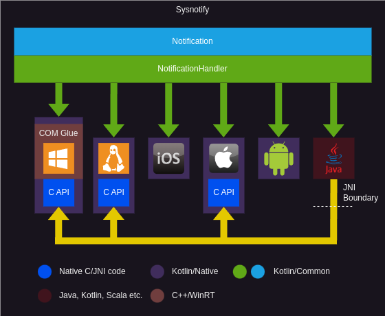

# Sysnotify

Cross-platform system notifications for Kotlin Multiplatform.

## Supported features

The support matrix below indicates which specific features are available on which platforms.

|              | Android   | iOS  | Windows  | macOS  | Linux | Browser |
|--------------|-----------|------|----------|--------|-------|---------|
| Title        | ✅        | ✅   | ✅       | ✅     | ✅    | ✅    |
| Description  | ✅        | ✅   | ✅       | ✅     | ✅    | ✅    |
| Icon         | ✅        | ❌   | ✅       | ❌     | ✅    | ✅    |
| Action       | ✅        | ✅   | ✅       | ✅     | ✅    | ✅    |
| Pop          | ✅        | ✅   | ✅       | ✅     | ✅    | ✅    |
| Sound        | ✅        | ✅   | ✅       | ✅     | ✅    | ✅    |
| Custom Sound | ✅        | ✅   | ✅       | ✅     | ✅    | ❌    |
| Grouping     | ✅        | ✅   | ❌       | ✅     | ❌    | ❌    |
| Status Icons | ✅        | ❌   | ❌       | ❌     | ❌    | ❌    |
| Icon Badges  | ✅        | ✅   | ❌       | ✅     | ❌    | ❌    |

**For the JVM, the same features as the respective host-native implementation are available.**

Supported features can be queried at runtime using the `capabilities` property of any
`NotificationHandler` instance.

## Supported platforms

### JVM

The JVM supports all native targets mentioned below for every architecture supported by Kotlin/Native.

### Android

Android is supported starting with **API level 28**.  

> **IMPORTANT NOTE**  
On Android you need to declare the `android.permission.POST_NOTIFICATIONS` permission in your app
manifest starting with **API level 33**.
See [here](https://developer.android.com/develop/ui/views/notifications/build-notification?hl=en).

> **IMPORTANT NOTE**  
In order for the `NotificationHandler` to work properly, a `Context` or `Activity` needs to be
attached in platform code using `NotificationHandler.withContext` or `NotificationHandler.withActivity`
respectively.

> **NOTE**  
Notification activations may be handled using `NotificationHandler.withActivationFactory`.

### macOS/iOS

macOS and iOS are supported starting with versions **10.14** and **10.0** respectively.

> **IMPORTANT NOTE**  
Since macOS and iOS internally use [bundleProxyForCurrentProcess](https://notprivateapis.com/documentation/notprivateapis/bundleproxyforcurrentprocess/),
which presumably is declared as `nonnull`, builds of the sample application or the application consuming SysNotify will
crash when not started with a valid bundle.  
This means that using `:sysnotify-sample:run` or `:sysnotify-sample:run_Executable_` will not work. Instead you need to
launch the **.app** file produced by the `:sysnotify-sample:packageDmg` task or install the **.dmg** that's also built in the process.

### Windows

Windows is supported starting with Windows 10.

### Linux

Linux is supported if your distribution/desktop environment supports [libnotify](https://github.com/GNOME/libnotify).  
This includes desktop environments which use Qt or GTK like [GNOME](https://www.gnome.org) or [KDE](https://kde.org).  

> **IMPORTANT NOTE**  
You need to have `libglib-2.0`, `libgdk-pixbuf-2.0` and `libnotify` installed via your
distribution package manager in order for notifications to show up.

## Example

Using Sysnotify is as easy as creating a `NotificationHandler` and calling the `push` function!  
The API is also completely thread-safe and works nicely with coroutines.

```kotlin
import android.os.Bundle
import androidx.activity.ComponentActivity
import de.connect2x.sysnotify.Notification
import de.connect2x.sysnotify.NotificationHandler

// Android activity usage example
class MyApplication : ComponentActivity() {
    internal lateinit var notificationHandler: NotificationHandler

    override fun onCreate(savedInstance: Bundle?) {
        super.onCreate(savedInstance)
        // This should be called as early as possible on EVERY platform
        NotificationHandler.installHooks()
        notificationHandler = NotificationHandler(
            name = "MyApp",
            id = "com.example.MyApp",
            // Specifying an activity for the context will automatically provide an activityGetter for you
            contextGetter = { this },
            permissionCallback = { if (!it) finishAffinity() }
        )
        runBlocking { notificationHandler.requestPermissions() }
        // ...
    }

    override fun onDestroy() {
        super.onDestroy()
        notificationHandler.close()
        // ...
    }

    internal fun onMessageReceived(message: Message) {
        // Process the message..
        runBlocking {
            notificationHandler.push(
                Notification(
                    title = message.sender.name,
                    description = message.content,
                    userData = "Custom data passed to the newly started activity"
                )
            )
        }
    }
}
```

## Architecture


